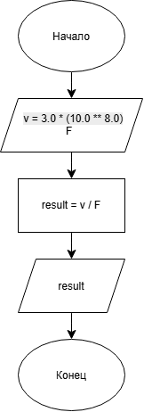

# Домашнее задание к работе 3

## Условие задачи

Написать и отладить программу расчета длины волны при заданной частоте сигнала. Возможный диапазон значений частоты — от 50 до 200 ГГц.

## 1. Алгоритм и блок-схема

### Алгоритм

1. **Начало.**
2. Задать исходные данные:
   - `v` — скорость света в метрах в секунду.
   - `F` — частота сигнала.
3. Определить длину волны:
   - `result = v / F`
4. Вывести результат расчета.
5. **Конец.**

### Блок-схема



## 2. Реализация программы

```c
#define _CRT_SECURE_NO_DEPRECATE
#include <locale.h>
#include <stdio.h>
#include <stdlib.h>
#define _USE_MATH_DEFINES
#include <math.h>

float Wavelength(float Velocity, float Frequency);

int main() {
    setlocale(LC_CTYPE, "");

    float v = 3.0 * pow(10.0, 8.0); // Скорость света
    float F;

    scanf("%f", &F);

    float result = Wavelength(v, F);
    printf("%.2f", result);

    return 0;
}

float Wavelength(float Velocity, float Frequency) {
    float WLenght = Velocity / Frequency;
    return WLenght;
}
```

## 3. Результаты работы программы

При частоте 85 Гц результат расчета составляет:

```text
3529411.75
```

## 4. Информация о разработчике

Измалком Илья бИД-261
